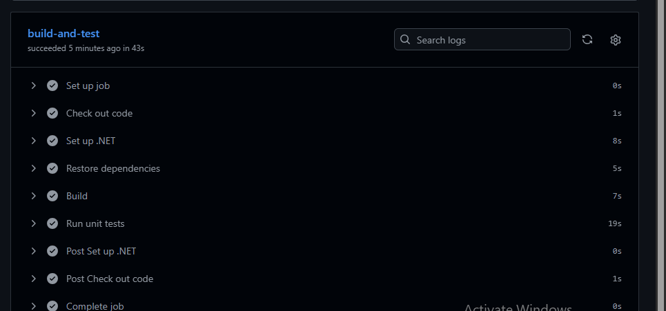

RaceDay System 

RaceDay is a web-based event management system designed for the South African running, walking, and cycling community. The system provides a central platform where event organisers can create and manage events, categories, routes, participants, registrations, and race results.

Participants can use the system to browse upcoming events, view event details and categories, register for races, and access their results and performance history. RaceDay can also provide useful **weather and route information** to help participants prepare for race day. Overall, the system aims to make the management of sporting events more organised, efficient, and accessible while providing participants with a convenient platform to manage their race activities.


---

# Part 2: RaceDay Web API

An ASP.NET Core Web API (.NET 10) with Entity Framework Core (code-first) and SQL Server. The API implements the endpoints from the Part 1 plan, with cookie-based sessions, hashed passwords, role-based access (Organiser and Participant), Swagger, and unit tests.

The code is in the `Part2` folder on the `part2-api` branch.

## Green build



The GitHub Actions workflow `Part 2 - Build and Test` builds the solution and runs all unit tests on every push to `part2-api`.

## How to run it

1. Install SQL Server Express and set the connection string in `Part2/RaceDay.Api/appsettings.json` (`Server=localhost\\SQLEXPRESS` by default).
2. Create the database from the code:
```
   cd Part2/RaceDay.Api
   dotnet ef database update
```
3. Start the API:
```
   dotnet run
```
4. Open the address printed after "Now listening on" and add `/swagger` (for example `http://localhost:5270/swagger`).

## How to run the tests

```
cd Part2/RaceDay.Tests
dotnet test
```

The tests start the API in memory with a temporary in-memory database, so no SQL Server is needed to run them.

## Authentication and roles

- Register with `POST /api/auth/register` and choose `Participant` or `Organiser`. The `Admin` role cannot be self-assigned.
- Log in with `POST /api/auth/login`. This starts a session (a cookie) that holds the user's role for every later request. Passwords are stored as salted hashes.
- Organisers manage venues, events, categories and results for their own events. Participants enter events, pay, and view their own results.
- Someone logged in with the wrong role gets **403**. Someone not logged in gets **401**.

## Changes from the Part 1 plan

- Cookie sessions replace the token endpoints. `refresh-token`, `forgot-password` and `reset-password` are not built.
- Added `POST /api/venues` and `GET /api/venues`, because an event needs a venue.
- Added `GET /api/results/me` so participants can view their own results.